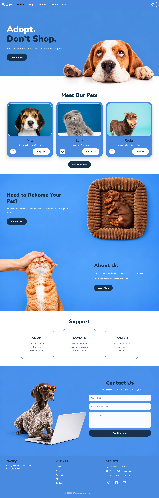
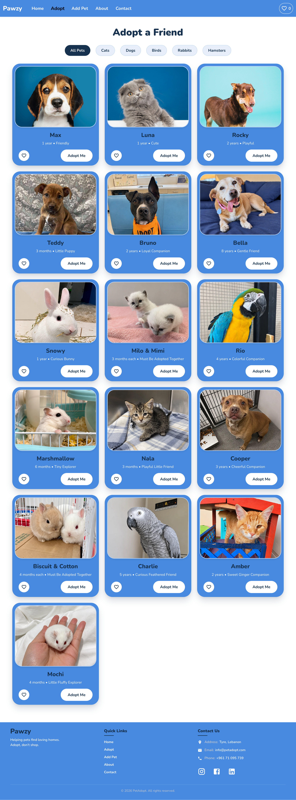
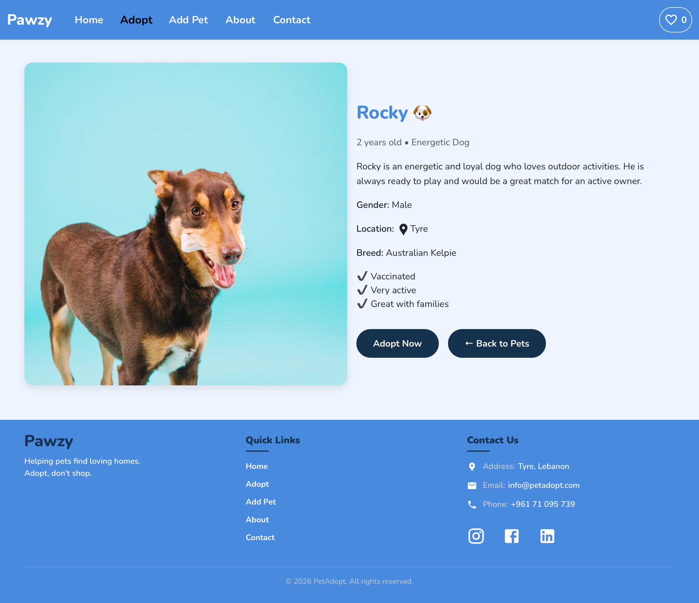
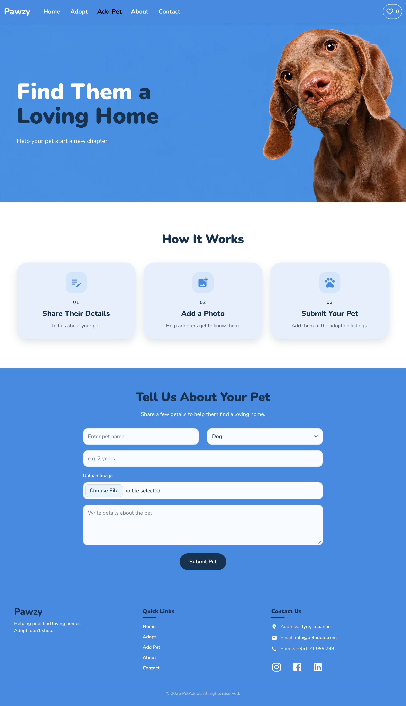
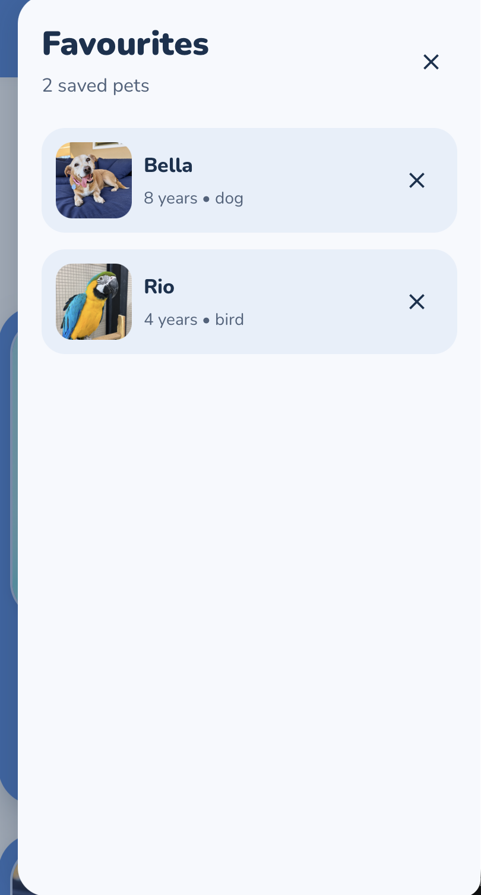

# Pawzy

Pawzy is a responsive pet-adoption website that helps people discover pets and find them loving homes. Users can browse animals, view their details, save favourites, and add a pet to the listings.

## Main features

- Three featured pets on Home: Max, Luna, and Rocky.
- Pet listings with animal-type filters and individual details.
- Favourite hearts and a drawer for viewing saved pets.
- An Add Pet form with validation and an optional local photo.
- A Contact form that validates entries and shows a local confirmation alert.
- A demo login screen and layouts for desktop and mobile.
- A visual Support section for adoption, donations, and fostering; its actions are planned for later.

This is an **individual Phase 1 frontend project**. Added pets, favourites, and login status reset on refresh. There is no real authentication or message delivery. Backend integration is planned for a later phase.

## Technologies

React, JavaScript, HTML, CSS, React Router, Bootstrap, Material UI Icons, React Icons, and Nunito. Development and builds use `react-scripts` (Create React App).

## Run locally

Install Node.js 20 or newer and npm, then run:

```bash
git clone https://github.com/mahdi-ali259/pet-adoption.git
cd pet-adoption
npm ci
npm start
```

Open `http://localhost:3000`. For demo login, use any valid email and a nonblank sample password.

Create a production build:

```bash
npm run build
```

The build is saved in `build/`.

## UI screenshots



Home page on desktop.



Pet listings and animal-type filters.



Details of a selected pet.



Form for adding a pet.



Saved pets in the favourites drawer.


Home page on mobile.

## Links

- [GitHub repository](https://github.com/mahdi-ali259/pet-adoption)
- [Live website on Vercel](https://pet-adoption-6x9g.vercel.app) — recorded in the previous project documentation; current availability has not been checked.

## Submission

- **Author:** Mahdi Ali — 12231975
- **Course:** CSCI426 Advanced Web Programming
- **Instructor:** Ghadir Khalil
- **Project:** Individual Phase 1 frontend submission

## Credits

Nunito is loaded through Google Fonts. Icons come from Material UI Icons and React Icons. Responsive layout uses Bootstrap.
